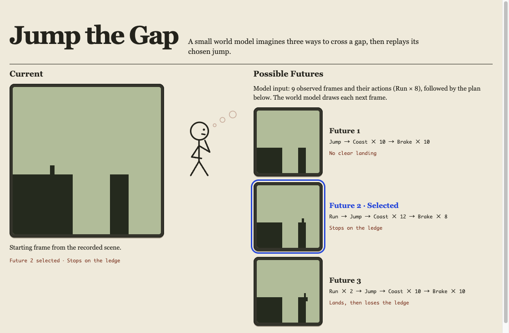
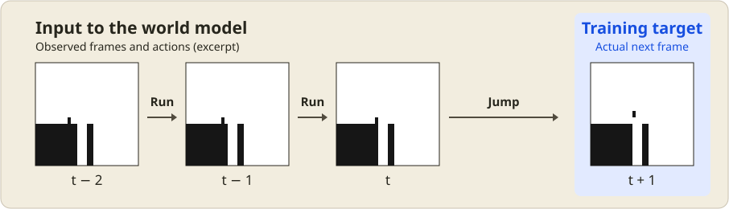

# Jump the Gap

[English](README.md)

崖を跳ぶ前に、3通りの跳び方を頭の中で試す小さな**世界モデル**です。32×32ピクセルの画像と操作から次のコマを描きます。描いたコマを次の入力に戻すことで、踏み切りから着地後までの映像をつくります。

**[ブラウザで見る](https://snc2work.github.io/jump-the-gap/)**



## 画面の見方

- **Current** に、学習に使っていないコースの踏み切り直前の場面が表示されます。
- **Possible Futures** に、その場で跳ぶ、あと1コマ走って跳ぶ、あと2コマ走って跳ぶ、という3案が並びます。案によってブレーキをかけるタイミングも変わります。
- 右の崖で止まると予測された案を優先し、選んだ映像を本画面で再生します。同点ならランダムに選び、再生後は別の崖へ進みます。

## 世界モデルについて

シミュレータで生成した動画を使い、因果トランスフォーマーを学習させます。モデルに渡すのは画像と操作IDだけです。各ステップで次の画像を4候補とそれぞれの確率で表し、その中から1つを選びます。踏み切り前の画像と操作が同じでも、学習データでは画素から見分けられない横速度の違いによって、着地の結果が変わります。



各コマは、崖と人物を含む32×32ピクセルの画像全体です。図のステップでは、それまでの画像と「跳ぶ」までの操作を使って次のコマを予測し、シミュレータが記録した次の画像を正解として学習します。モデルへの入力は画像と操作IDだけで、人物の動きは画像の変化に現れます。

Web版では3層モデル（779,684パラメータ）を、Web Worker内のONNX Runtime Webで動かします。生成した画像列から着地を判定し、その結果を使って3案を順位づけします。

## ローカルで動かす

Node.js 24.22.1以降とpnpm 10.33.2が必要です。学習済みモデルと開始場面を同梱しているため、Webデモの起動にPython環境は不要です。

```sh
cd web
pnpm install --frozen-lockfile
pnpm dev
```

ターミナルに表示されたURLを開きます。`pnpm build` でTypeScriptの型をチェックし、`web/dist/` に配信用ファイルを出力します。

## 学習用動画の生成

データ生成・再学習・ONNX出力にはPython 3.13と仮想環境を使います。NumPy、PyTorch、ONNXのバージョン範囲は [requirements.txt](requirements.txt) に記載しています。学習はPyTorchのMPSが使える環境ではMPSを使い、それ以外ではCPUで実行します。

リポジトリのルートで次を実行します。

```sh
python3.13 -m venv .venv
.venv/bin/python -m pip install -r requirements.txt
.venv/bin/python generate.py data
```

`train.npz` と `test.npz` に32×32の二値画像を33コマずつ収録する。`frames[:, t]` に `actions[:, t]` を適用した結果が `frames[:, t + 1]`。操作IDは 0 が惰性で進む、1 が走る、2 が跳ぶ、3 がブレーキ。学習器に渡すのは画像と操作の二つ。

右の崖は幅2〜6ピクセル、間隔は3〜10ピクセル。40通りのうち10通りはコースごと評価用に取っておく。各操作列に対し、踏み切り時の横方向の速度差を4通り試す。踏み切り前の画像列と操作列を揃えたまま、その後の軌道と着地結果に幅が生まれる。

`*_evaluation.npz` には、画像履歴と操作列を共有する動画のグループID、崖の間隔と幅、シミュレータでの結果を保存する。標準のシードでは学習17,280本、評価5,760本。右の崖で止まる未来と、着地後に落ちる未来の両方を含む評価グループが169組ある。

## トランスフォーマーの学習と評価

```sh
.venv/bin/python train.py --steps 2000 --layers 2 --output data/compare-2layers.pt
.venv/bin/python evaluate.py --layers 2 --checkpoint data/compare-2layers.pt
.venv/bin/python train.py --steps 2000 --layers 3 --output data/compare-3layers.pt
.venv/bin/python evaluate.py --layers 3 --checkpoint data/compare-3layers.pt
```

2層と3層を、同じ順番の学習サンプルで2,000ステップずつ比較した。未学習の崖から24例を選び、同じ画像履歴と操作列から12回ずつ生成した。

| 指標 | 2層 | 3層 |
| --- | ---: | ---: |
| パラメータ数 | 686,372 | 779,684 |
| 次の1コマの完全一致 | 74.9% | 77.4% |
| 着地して止まるか、着地後に落ちるかのどちらかを描けた | 13/24 | 12/24 |
| 上記の両方を描けた | 0/24 | 3/24 |
| シミュレータの動画と完全一致する未来がどちらか一方でも出た | 0/24 | 2/24 |

直前のコマをそのまま出す基準での完全一致率は38.9%。層数の比較はシード42の一回分。

## モデルが描いた未来を見比べる

```sh
.venv/bin/python export_preview.py
open data/preview.html
```

3層モデルが評価時と同じ条件で生成した24例×12本を、単体で開けるHTMLに収める。左の **Current** は学習に使っていないコースの踏み切り直前の観測画像。右の **Possible Futures** は、その画像履歴と同じ操作列からモデルが先を描いた二つの動画。表示するコマやサンプルを切り替えられる。両方の着地結果が見えた3例はシーン一覧の先頭に置いた。

## Web用モデルの再出力

3層モデルを学習した後、リポジトリのルートで次を実行します。

```sh
.venv/bin/python export_web.py
```

ONNXモデルと7コース分の開始場面を `web/public/model/` に出力します。

## ライセンス

[MIT](LICENSE)
