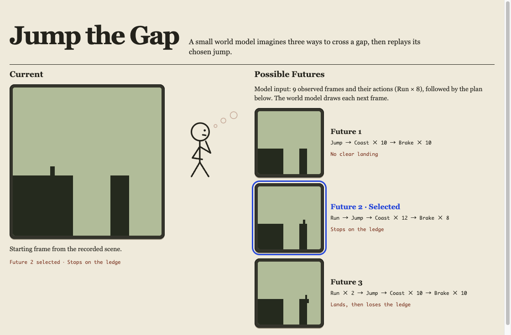
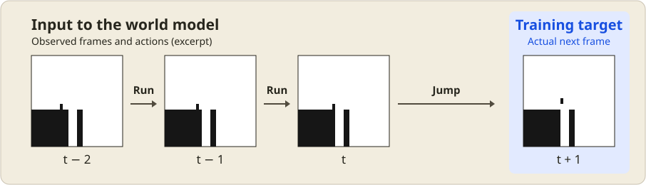

# Jump the Gap

[日本語](README.ja.md)

Jump the Gap is a browser demo in which a small **world model** imagines three ways to jump across a gap. The demo plays back one of those futures on the main screen.

I made this to see what a world model could do in a small experiment. Could it draw what happens next from images and actions alone? Could it start from the same scene and predict a different future for each jump plan?

I used a simulator with rules for gravity and landing to generate the training clips. In the demo, the model draws each new 32×32 frame and feeds it back in to predict the next one. That lets you watch each plan play out from takeoff through landing.

The model drew jumps where the jumper landed and stopped on the far ledge, and others where the jumper landed and then fell off. I sampled 12 futures per scene using the same actions each time. Both outcomes appeared in 3 of the 24 scenes the model had not trained on. Drawing a coherent sequence through landing was still difficult.

**[Watch the demo in your browser](https://snc2work.github.io/jump-the-gap/)**



## What you'll see

- **Current** shows a recorded scene from a course held out of training.
- **Possible Futures** compares three plans from that scene: jump now, run one more step, or run two more steps. Brake timing also varies across the plans.
- The demo favors a prediction where the jumper stops on the far ledge. It replays the chosen prediction on the main screen, then moves to a different course. Ties are broken at random.

## How the model works

A simulator generates the training clips. The Transformer learns from binary images and four actions: coast, run, jump, and brake. Each step produces four candidate images and samples one. The training clips include jumps with the same visible lead-up and action sequence but slightly different takeoff speeds, so more than one landing outcome can fit the same input.



Each input frame is the entire 32×32 image, including the ledges and the jumper. For the step shown here, the model sees the observed frames and the actions through Jump. Its prediction is trained against the next frame recorded by the simulator. Images and action IDs are the only inputs. The sequence of frames shows how the jumper moves.

The browser runs the three-layer model (779,684 parameters) with ONNX Runtime Web inside a Web Worker. The demo reads the generated frames to rank the three plans by their predicted landing outcomes.

## Results

The two models were trained for 2,000 steps each using the same minibatch order. For the rollout comparison, each model sampled 12 futures from each of 24 held-out scenes with a fixed action sequence.

| Metric | 2 layers | 3 layers |
| --- | ---: | ---: |
| Exact next frame | 74.9% | 77.4% |
| Drew a stop or a fall after landing | 13/24 | 12/24 |
| Drew both outcomes | 0/24 | 3/24 |
| Exactly matched a simulator clip for either outcome | 0/24 | 2/24 |

Copying the previous frame gives 38.9% exact next frames. The results are from a single run with seed 42.

## Run locally

Requires Node.js 24.22.1 or later and pnpm 10.33.2. The trained ONNX model and seven starting scenes are included, so the Web demo runs without a Python environment.

```sh
cd web
pnpm install --frozen-lockfile
pnpm dev
```

Open the URL printed by Vite. Run `pnpm build` from `web/` to type-check the TypeScript source and build the static site.

## Reproduce the model

Use Python 3.13 and a virtual environment with NumPy, PyTorch, and ONNX. The dependency ranges are in [requirements.txt](requirements.txt). Training uses PyTorch’s MPS backend when available and otherwise runs on the CPU.

Run these commands from the repository root to generate the data, train the three-layer model, evaluate it, and export the browser assets.

```sh
python3.13 -m venv .venv
.venv/bin/python -m pip install -r requirements.txt
.venv/bin/python generate.py data
.venv/bin/python train.py --steps 2000 --layers 3 --output data/compare-3layers.pt
.venv/bin/python evaluate.py --layers 3 --checkpoint data/compare-3layers.pt
.venv/bin/python export_web.py
```

`export_web.py` updates the assets under `web/public/model/`. To save a standalone replay of sampled futures, run `.venv/bin/python export_preview.py` and open `data/preview.html`.

## Related projects

- [ABYSS GEMS](https://github.com/snc2work/abyss-gems) is a two-player falling-block puzzle where a world model predicts how the board changes during a match.
- [Little Quest](https://github.com/snc2work/little-quest) is a playable 32×32 adventure where a world model draws the next frame from the current image and your input.

## License

[MIT](LICENSE)
